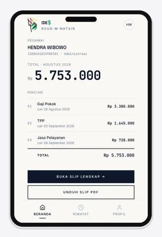
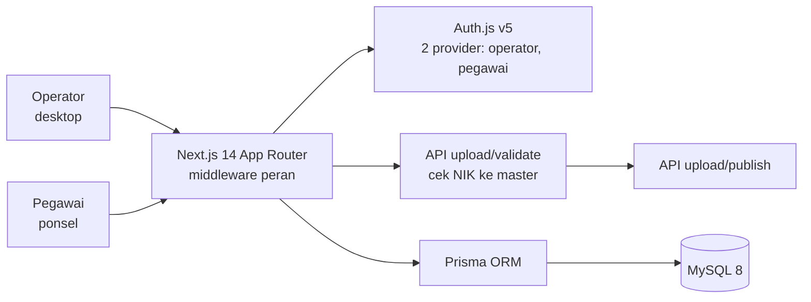
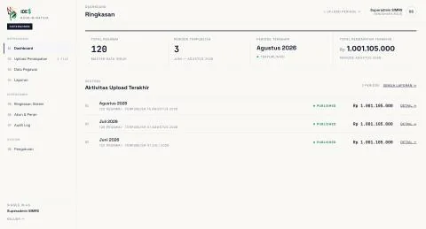
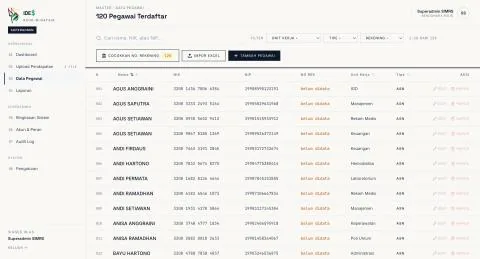

# IDE$ — Portal Slip Gaji Pegawai RSUD M. Natsir

> *Payroll Slip Portal* — platform digital untuk mengelola dan menyediakan dokumen slip gaji pegawai rumah sakit. Menggabungkan tiga komponen penghasilan (Gaji Pokok, TPP, dan Jasa Pelayanan) dalam satu kode dengan dua tampilan: konsol operator di desktop dan portal pegawai di ponsel.

| | |
|---|---|
| Instansi | RSUD Mohammad Natsir Solok, Instalasi SIMRS |
| Peran saya | Solo end-to-end: desain skema database, backend, frontend, deployment |
| Data awal | 462 data master pegawai |
| Status | Produksi, dipakai internal |

## Masalah yang diselesaikan

Slip penghasilan sebelumnya dibagikan dari tiga berkas Excel terpisah (gaji, TPP, jasa pelayanan). Pegawai sulit melihat total penghasilan dan riwayatnya, sementara operator harus mencocokkan data secara manual. IDE$ mendigitalkan administrasi slip gaji dan memudahkan pegawai mengakses dokumen penghasilannya sendiri.

## Fitur utama

**Operator (desktop)**
- Unggah tiga berkas penghasilan sekaligus dalam satu halaman; parsing Excel di server (SheetJS).
- Validasi NIK terhadap master pegawai **sebelum** data dipublikasikan, termasuk pencocokan rekening bank.
- Draf sinkronisasi: data diperiksa dulu, baru dipublikasikan per periode.
- Manajemen master pegawai, laporan per periode, pengaturan aplikasi.
- Audit log untuk setiap perubahan data, dan pemisahan peran operator / bendahara / superadmin.

**Pegawai (mobile)**
- Login dengan NIK/NIP.
- Dashboard penghasilan periode berjalan beserta rincian dan tanggal pencairan.
- Riwayat antar periode dengan total kumulatif.
- Slip digital dalam HTML yang bisa dicetak ke PDF langsung dari browser (tanpa Chromium di server).

## Arsitektur

## Model data (ringkas)

`User` (operator) · `Employee` (master pegawai) · `Upload` (berkas per periode) · `SyncDraf` (data sebelum publish) · `AuditLog` · `Setting`

## Tech stack

| Lapis | Teknologi |
|---|---|
| Aplikasi | Next.js 14 (App Router), TypeScript |
| Auth | Auth.js v5 (operator: kredensial; pegawai: NIK/NIP) |
| Data | MySQL 8 via Prisma ORM |
| UI | Tailwind CSS, komponen kustom |
| Excel | SheetJS (xlsx) |
| Deploy | Docker Compose di server rumah sakit |

## Galeri

| | |
|---|---|
|  |  |

---

> **Catatan kerahasiaan.** Kode sumber aplikasi ini private karena milik/dipakai instansi. Repo ini hanya menjelaskan konteks, fitur, arsitektur, dan peran saya. Tidak ada kode, data pegawai, data pasien, alamat server, maupun kredensial di sini.

**Maizan Insani Akbar** · Software Engineer & System Analyst · [Portfolio](https://izanmaizan.vercel.app) · [LinkedIn](https://www.linkedin.com/in/izanmaizan/) · [GitHub](https://github.com/izanmaizan)
